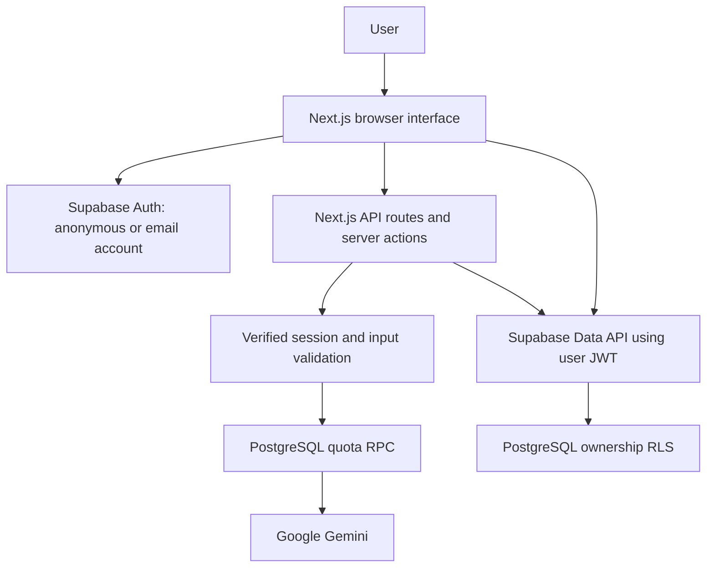

# Architecture

## Request and authentication flow

The browser uses a publishable/anon key and Supabase SSR cookies. AuthStatus bootstraps an authenticated anonymous user on practice pages. The Next.js proxy refreshes authentication cookies. Every protected server operation calls getUser to verify the session; it does not accept a browser user ID. Profile reads are browser queries filtered to the verified ID and protected by RLS.

## Communication and interview flow

General practice uses speech recognition where available, editable text, recording playback and optional Gemini transcription. Interview setup generates five questions from a bounded job description, focus and optional PDF/DOCX/text resume. Questions and setup preferences remain in browser localStorage. The interview interface can speak questions using browser speech synthesis.

Each coaching request streams Markdown, then makes a second structured Gemini call for a validated score, weakness, fix and dimension scores. The client accepts completion only after the structured result arrives. Failed or canceled streams do not become saved feedback. Retrying records an improvement relative to the prior attempt. Zero is a valid score.

## Persistence and history

On session end, the client submits an ID and bounded session data to savePracticeSession. A security-invoker RPC derives auth.uid and atomically inserts the parent session, feedback and aggregate dimensions. Repeating the same ID returns the previously saved session instead of duplicating records. Save failures retain the pending payload in component memory and expose a retry button.

History explicitly filters the verified owner and reads the most recent 200 sessions, ordered chronologically for analysis. Dashboard totals therefore describe that bounded window, not an unlimited lifetime dataset. AI insights use aggregate scores and weaknesses; full transcripts are not included in this request. The owner's profile stores the validated insight cache.

Pending saves and interview questions are not a durable offline queue. Leaving/reloading the practice page can lose an unsaved session. Account login does not merge anonymous users or old UUID-based guests.
